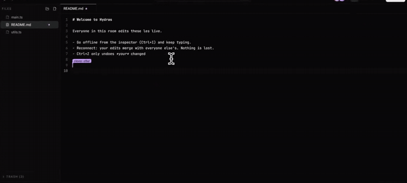
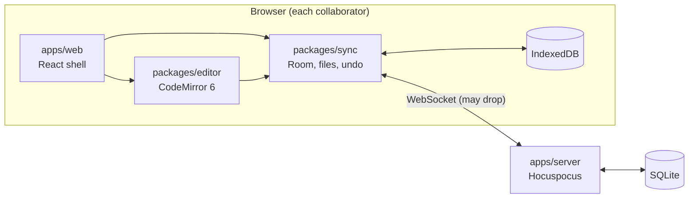

# Hydras

Offline-first multiplayer code workspace. 4+ people edit the same files live, keep working
through bad Wi-Fi, and everything merges on reconnect. Edits are never lost, and undo only
touches your own changes.

## Demo

Three people in one room typing the same file, with live cursors.



The [full 53-second walkthrough](docs/demo.mp4) also shows the landing page and settings.

## LAN collaboration release (0.2)

Use the Windows installer or portable ZIP from [GitHub Releases](https://github.com/Arjun-Walia/Hydras/releases). The portable entry point is `START-HYDRAS.cmd`; it opens the local browser app. The desktop installer bundles the local Node launcher and sync server.

1. Connect everyone to the same trusted Wi-Fi/hotspot. Internet is not needed.
2. Choose **Host a protected workspace**, set a password, and **Share** the invite.
3. Friends paste the invite into **Join with a link**, supply the password, and request access.
4. The host approves editors/viewers in **Workspace tools**. Permissions are enforced at the server, including forged viewer writes and revocation.
5. Attach a project folder **inside that room** to retain its permissions. The host's folder receives shared edits; other laptops keep browser copies unless they export.

**Workspace tools** includes connection diagnostics, ten local recovery checkpoints, JSON export/import, and member management. Recovery creates separate recovered files without overwriting live content. Local-save confirmation comes from an IndexedDB transaction; host-sync confirmation comes from protocol acknowledgments, not a disk-backup guarantee. The app shell is cached for offline reload after its first successful load.

See [the complete two/four-laptop checklist](scripts/LAN-TEST.txt) and [verification evidence and limits](docs/collaboration-acceptance.md).

### Rebuild and verify the downloadable package

```powershell
pnpm check
pnpm --filter @hydras/web build
node scripts/package-lan.mjs
node scripts/collaboration-integration.mjs
pnpm --filter @hydras/desktop build:desktop
```

The package is staged in `dist/Hydras-LAN-v2-Windows`. Keep user data out of build staging. For a longer network partition test set `HYDRAS_PARTITION_MS=60000` before the integration script. The server test uses an isolated temporary database and port 18341.

Updates are explicit downloads from the app's **Downloads and updates** link. Install over the previous desktop version; preserve portable `data/` when updating. There is no signed automatic background updater. Windows installers require WebView2 (downloaded if absent), so prepare that prerequisite before going offline.

LAN HTTP/WS is unencrypted; use trusted networks, and HTTPS/WSS for remote deployment. Existing open rooms remain open. The host must stay awake; there is no host failover. Cached data cannot be remotely erased after revocation. Undo history is not persisted across reloads. Back up SQLite and `access.json` together with the app closed.

## 60-second quickstart

```bash
pnpm install
pnpm dev            # sync server on :1234 + web app on :5173
```

Open <http://localhost:5173> for the landing page and click **Open a room**, then open the
same `/r/<room>` URL in a second window. Press `Ctrl+I` for the sync inspector and use
**Go offline** to simulate bad Wi-Fi.

| Command                | What it does                                             |
| ---------------------- | -------------------------------------------------------- |
| `pnpm dev`             | Server + web with hot reload                             |
| `pnpm dev:desktop`     | Desktop app (Tauri) against the web dev server           |
| `pnpm test`            | Unit, property and policy tests (Vitest)                 |
| `pnpm check`           | Lint (incl. module boundaries), types, tests             |
| `pnpm build`           | Production build of the web app                          |
| `pnpm release:desktop` | Build the Windows installers and stage them for the site |

Config lives in `.env` (see `.env.example`): `VITE_SYNC_URL`, `PORT`, `SQLITE_PATH`.

## Settings

`Ctrl+,` (or the gear in the title bar) opens Settings, modelled on Opcodex:

- **Theme**: Hydras Graphite / Paper plus 8 community palettes. **Import** and **Export**
  `.hydras-theme.json` files; Opcodex `opcodex-theme/1` files import too. Only hex colors
  are accepted, so a theme file can't inject CSS.
- **Workspace layout**: Explore, Pair, Focus and Review presets, or your own mix of the
  files panel (`Ctrl+B`), sync inspector (`Ctrl+I`) and compact rows.
- **Editor**: code size 11–18 px, line numbers, wrap long lines. Applied live.
- **Sync server**: the `ws://` / `wss://` address rooms sync through (needed for the
  desktop app).
- **General**: reduce motion, shortcuts, reset.

Settings are saved per device and validated on load.

## Open your codebase

**Open folder…** (start screen, file tree, or `Ctrl+K`) turns a folder on your disk into a
room. The person who opens it hosts the folder; collaborators join with the link.

- Imports every text file under the folder, honouring `.gitignore`; skips `.git`,
  `node_modules`, `target`, `dist`, `build`, binaries and files over 1 MB.
- Edits from anyone in the room are written to disk (atomic writes, debounced). Changes
  made on disk by git, a formatter, another editor or the terminal flow back into the room
  as minimal diffs, so open editors and other people's cursors survive.
- Line endings are kept per file: CRLF files stay CRLF on disk.
- Safety: Hydras never deletes or overwrites files outside the room's edits. Deleting or
  renaming in the room leaves the old file on disk; a file deleted on disk goes to Trash.
  The desktop shell only touches folders you picked in its native dialog, and refuses
  `..`, absolute paths and symlinks that leave the folder.
- In the browser this works in Chrome / Edge (File System Access API). After a reload the
  browser asks for permission again via a **Reconnect folder** button.

## Terminal

`` Ctrl+` `` (or **Terminal** in the status bar) opens real shells on a native PTY (ConPTY
on Windows): PowerShell 7 if installed, else Windows PowerShell; `$SHELL` on macOS/Linux.
They start in the opened folder, support tabs, resize, colors and restart. Terminals are
local to you, not shared in the room, and need the desktop app: a browser tab cannot start
processes, and the panel says so.

## Desktop app (Windows)

`apps/desktop` is a [Tauri 2](https://tauri.app) shell around the same web build: one
native window, WebView2, no extra native permissions (`core:default` only). At `/` it
shows a start screen (new room, join by link, settings) instead of the marketing page.

```bash
pnpm release:desktop   # needs Rust (stable) + MSVC build tools + WebView2
```

This writes `Hydras_<version>_x64-setup.exe` (NSIS, per-user install) and
`Hydras_<version>_x64_en-US.msi` under `apps/desktop/src-tauri/target/release/bundle/`,
then copies them to `apps/web/public/downloads/` with a `manifest.json` (size + SHA-256)
that the landing page's Download section reads.

To ship a release, push a tag like `v0.1.0`: `.github/workflows/release.yml` builds the
installers on Windows and attaches them to a **draft** GitHub release for you to review.
Set the repository variable `VITE_SYNC_URL` so the desktop build points at your hosted
sync server.

## Deploy

Two pieces: a static web app and one long-running sync server (WebSockets + SQLite).

**Sync server (Fly.io, or any Docker host with a volume)**

```bash
fly launch --no-deploy --copy-config      # pick an app name and region
fly volumes create hydras_data --size 1
fly deploy                                 # builds apps/server/Dockerfile
```

The image listens on `8080` and stores rooms in `/data/hydras.sqlite`; mount a volume
there. Locally: `docker build -f apps/server/Dockerfile -t hydras-sync .` then
`docker run -p 8080:8080 -v hydras-data:/data hydras-sync`.

**Web app (Vercel)**

Import the repo in Vercel; `vercel.json` sets the pnpm install, the
`@hydras/web` build, SPA rewrites and security headers. Add the environment variable
`VITE_SYNC_URL=wss://<your-sync-app>.fly.dev` and deploy. Any static host works the same
way: serve `apps/web/dist` with a fallback to `index.html`.

## Brand assets

The logo lives in `assets/brand/` (`logo.svg`, square, app-icon and maskable variants,
plus the source image). Web favicons, PWA icons and the 1200×630 social card are in
`apps/web/public/`; desktop icons are generated with `pnpm --filter @hydras/desktop icons`.

## Architecture



| Package           | Owns                                                       | Must not                       |
| ----------------- | ---------------------------------------------------------- | ------------------------------ |
| `packages/sync`   | Y.Doc, provider, connection state machine, files API, undo | Import React                   |
| `packages/editor` | CodeMirror setup, theme, Yjs binding                       | Import yjs or the network      |
| `packages/ui`     | Tokens and presentational primitives                       | Know about documents           |
| `packages/shared` | Types, palette, identity helpers                           | Have runtime dependencies      |
| `apps/web`        | Layout, presence UI, inspector, palette                    | Import yjs / y-\* / hocuspocus |
| `apps/server`     | Rooms, persistence, auth hook                              | Interpret document contents    |

These boundaries are enforced by `no-restricted-imports` in `eslint.config.js`.

## How sync works, in 10 lines

1. One room = one `Y.Doc`; each file is a `Y.Text` inside a `files` map keyed by stable id.
2. Yjs gives every inserted character a unique `(client, clock)` id, so merges never lose text.
3. On load, the doc is restored from IndexedDB **before** the socket connects (local-first).
4. While offline, edits apply locally and are counted as pending changes.
5. On reconnect, client and server exchange state vectors and send only what the other lacks.
6. Applying the same update twice is a no-op, so replays and retries are safe.
7. Every transaction has an origin: local, files, remote (provider) or storage (IndexedDB).
8. Each file gets its own `Y.UndoManager` that tracks only local origins: undo is per user.
9. File deletes are soft, so "A deletes while B edits offline" lands in Trash with B's edits.
10. Presence (name, color, caret, active file) travels in Awareness and is never persisted.

## Tests

`packages/sync` holds the proofs: convergence and idempotency property tests (fast-check,
4 replicas, shuffled and duplicated delivery, partitions), per-user undo scenarios, file
conflict policy, and the connection state machine. Design notes and ADRs live in the
Obsidian vault (`Hydras/`).

## Known limitations

- Undo stack is in memory: cleared on reload.
- Legacy/open rooms use the room link as access control. New protected rooms require a password, member approval and an issued token.
- Web bundle is one ~1 MB chunk; code-split CodeMirror languages when it matters.
